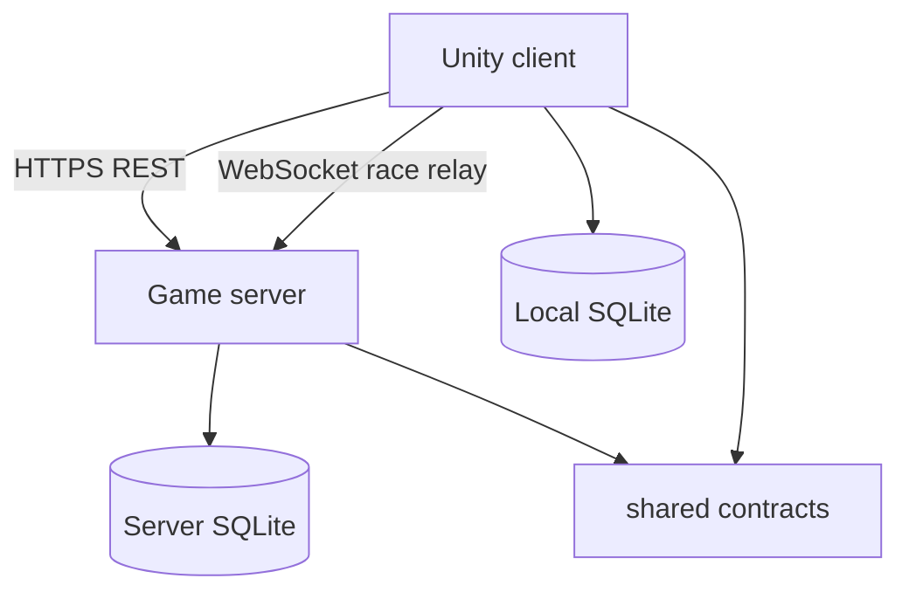

# Design: 3D Car Racing Game

## Overview

The game is a Unity project in C# that ships to Android, iOS, Windows and macOS, with a .NET multiplayer game server that runs in the cloud. A Player signs in, picks a mode from the main menu, races a supercar on one of 15 tracks against 7 AI opponents or up to 7 other Players, and earns cars, upgrades and experience by racing. Every record the Player cares about — account, profile, car collection, upgrades, race history, achievements and game progress — is kept in SQLite: on the device for offline play, and on the server as the source of truth that syncs to every device the Player signs in on.

The game copies the smooth arcade handling and quick race flow of Asphalt 9, Real Racing 3 and CarX Street, and avoids their pay-to-win upgrades and forced ads: cars and upgrades are earned by racing only, and no advertisement appears between a race's start and its results screen.

## Architecture

Three parts, each a separate build:

- **Unity client** (`client/`) — the game itself: menus, garage, race scene, physics, audio, rendering. It reads and writes a local SQLite database so single-player modes work offline, and talks to the server over HTTPS and a WebSocket for multiplayer.
- **Game server** (`server/`) — an ASP.NET Core (.NET 8) service that owns the authoritative SQLite database, serves accounts, profiles, leaderboards, race history and the multiplayer matchmaking and race relay. It is the only place a race result is trusted.
- **Shared contracts** (`shared/`) — a C# class library of the request and response models and the WebSocket message types, referenced by both the client and the server, so the two sides cannot drift apart.



The client never trusts its own race result for the leaderboard: it reports the result to the server, and the server checks it against the race it ran (Requirement 8.7). Offline, the client records the race in its local SQLite database and sends it when the connection returns (Requirement 12.3).

## Components and Interfaces

### Unity client

| Component | Responsibility |
| --- | --- |
| `AuthService` | Sign-up, sign-in, sign-out, account deletion; keeps the session token. |
| `ProfileStore` | Reads and writes the Player profile, car collection, upgrades, achievements and game progress in local SQLite. |
| `RaceHistoryStore` | Records finished races locally and queues offline races for sync. |
| `SyncService` | Sends queued offline races and pulls the server's records when the connection returns. |
| `RaceController` | Runs the race: countdown, laps, finish, results hand-off. |
| `CarPhysics` | Arcade handling: acceleration, braking, drifting, nitro, collisions. |
| `AiDriver` | Drives the 7 AI opponents at their difficulty. |
| `HudController` | Speedometer, gear, nitro bar, lap counter, drift score, lap timer. |
| `ChaseCamera` | Follows the Player's car behind and through turns. |
| `GraphicsQuality` | Measures frame rate and lowers quality to keep the target. |
| `MultiplayerClient` | Matchmaking, car choice, race relay over WebSocket. |
| `AudioDirector` | Engine sound, tyre and impact sounds, music. |

### Game server

| Component | Responsibility |
| --- | --- |
| `AuthEndpoints` | `/api/auth/*` — sign-up, sign-in, sign-out, delete account, password reset. |
| `ProfileEndpoints` | `/api/profile` — the signed-in Player's profile, collection, progress. |
| `GarageEndpoints` | `/api/garage/*` — install upgrade, save customization. |
| `RaceEndpoints` | `/api/races` — submit a finished race, list race history. |
| `LeaderboardEndpoints` | `/api/leaderboards/{trackId}` — top 100 and the Player's rank. |
| `CareerEndpoints` | `/api/career` — stages, completed races, rewards. |
| `SupportEndpoints` | `/api/support/*` — support reads an account and its race history, resets a password. |
| `Matchmaker` | Groups Players by car class and career level, starts at 8 or after 30 seconds. |
| `RaceRelay` | WebSocket `/ws/race` — relays car state, validates the finish, records the result. |
| `HealthEndpoints` | `/api/health` — liveness for the monitor. |

### API endpoints

All endpoints are under the server's base URL, take and return JSON, and answer `401` with `{"error":"Not signed in"}` when the session token is missing or expired. A validation failure answers `400` with `{"error":"<message>"}` where the message is the one the requirements name.

| Method | Path | Request body | Success answer |
| --- | --- | --- | --- |
| POST | `/api/auth/signup` | `{"username","email","password"}` | `201 {"token","player":{"id","displayName","level","experience","currency"}}` |
| POST | `/api/auth/signin` | `{"email","password"}` | `200 {"token","player":{...}}` |
| POST | `/api/auth/signout` | — | `204` |
| DELETE | `/api/auth/account` | — | `202 {"deletionScheduledFor"}` |
| POST | `/api/auth/password-reset` | `{"playerId","newPassword"}` (support only) | `200 {"signedOutDevices":<count>}` |
| GET | `/api/profile` | — | `200 {"id","displayName","level","experience","experienceToNextLevel","currency","careerStage","unlockedTracks","unlockedCars"}` |
| GET | `/api/garage` | — | `200 {"cars":[{"carId","model","class","stats","upgrades":[{"part","level"}],"customization":{"paint","decal"}}]}` |
| POST | `/api/garage/{carId}/upgrade` | `{"part"}` | `200 {"car":{...},"currency"}` or `400 {"error":"Not enough currency"}` or `400 {"error":"Upgrade cost too high"}` |
| PUT | `/api/garage/{carId}/customization` | `{"paint","decal"}` | `200 {"car":{...}}` |
| POST | `/api/races` | `{"trackId","carId","mode","position","totalTimeMs","bestLapMs","laps":[{"lapNumber","timeMs"}],"finishedAt"}` | `201 {"raceId","currencyEarned","experienceEarned","levelUp","unlockedAchievements":[...]}` or `409 {"error":"Result does not match the race"}` |
| GET | `/api/races` | — | `200 {"races":[{"raceId","trackId","carId","upgrades","result","timeMs","date"}]}` |
| GET | `/api/leaderboards/{trackId}` | — | `200 {"entries":[{"rank","displayName","carModel","timeMs"}],"player":{"rank","timeMs"}}` |
| GET | `/api/career` | — | `200 {"stages":[{"stageNumber","races":[{"raceId","trackId","completed"}],"rewardCarId"}]}` |
| POST | `/api/career/{raceId}/complete` | — | `200 {"career":{...},"unlocked":[...]}` |
| GET | `/api/support/accounts/{playerId}` | — | `200 {"account":{...},"races":[...]}` (support role only) |
| GET | `/api/health` | — | `200 {"status":"ok"}` |

### WebSocket messages

The client opens `wss://<server>/ws/race?token=<session token>`. Every message is JSON with a `type` field.

| Type | Direction | Payload |
| --- | --- | --- |
| `match.join` | client → server | `{"carClass","careerLevel","carId"}` |
| `match.found` | server → client | `{"raceId","trackId","players":[{"playerId","displayName","carId"}],"startsInMs"}` |
| `race.state` | client → server | `{"raceId","tick","position":{"x","y","z"},"speedKmh","lap"}` (20 times a second) |
| `race.snapshot` | server → client | `{"raceId","tick","cars":[{"playerId","position","speedKmh","lap"}]}` |
| `race.finished` | client → server | `{"raceId","totalTimeMs","bestLapMs","laps":[...]}` |
| `race.results` | server → client | `{"raceId","standings":[{"playerId","displayName","position","totalTimeMs"}]}` |
| `race.rejected` | server → client | `{"raceId","reason"}` — the result did not match the race the server ran |

The server keeps the authoritative lap and finish times from `race.state`; a `race.finished` that disagrees with them is answered with `race.rejected` and no race history is written (Requirement 8.7).

### Shared state between screens

Screens do not call each other directly. They read and write the local SQLite database through `ProfileStore` and `RaceHistoryStore`, and raise these events on the `GameEvents` static class:

| Event | Carries | Raised by | Read by |
| --- | --- | --- | --- |
| `RaceFinished` | `raceId`, `trackId`, `carId`, `position`, `totalTimeMs`, `bestLapMs`, `currencyEarned`, `experienceEarned` | `RaceController` | Race results screen, main menu |
| `ProfileChanged` | the updated `PlayerProfile` | `ProfileStore` | Main menu, garage, career |
| `CarUnlocked` | `carId` | `CareerService` | Garage, main menu toast |
| `AchievementUnlocked` | `achievementId`, `name` | `AchievementService` | Main menu toast |
| `ConnectionChanged` | `isOnline` | `SyncService` | Main menu, multiplayer screen |

## Data Models

SQLite, on both the device and the server, with the same schema. The server's copy is authoritative; the device's copy is the offline working set.

```sql
CREATE TABLE accounts (
  id            TEXT PRIMARY KEY,
  username      TEXT NOT NULL UNIQUE,
  email         TEXT NOT NULL UNIQUE,
  password_hash TEXT NOT NULL,
  state         TEXT NOT NULL DEFAULT 'registered', -- registered | active | suspended
  created_at    TEXT NOT NULL
);

CREATE TABLE player_profiles (
  player_id        TEXT PRIMARY KEY REFERENCES accounts(id) ON DELETE CASCADE,
  display_name     TEXT NOT NULL,
  level            INTEGER NOT NULL DEFAULT 1,
  experience       INTEGER NOT NULL DEFAULT 0,
  currency         INTEGER NOT NULL DEFAULT 0,
  career_stage     INTEGER NOT NULL DEFAULT 1,
  progress_state   TEXT NOT NULL DEFAULT 'in_progress' -- in_progress | completed
);

CREATE TABLE cars (
  id        TEXT PRIMARY KEY,
  model     TEXT NOT NULL,
  class     TEXT NOT NULL,          -- D | C | B | A | S
  top_speed INTEGER NOT NULL,
  accel     INTEGER NOT NULL,
  handling  INTEGER NOT NULL,
  price     INTEGER NOT NULL
);

CREATE TABLE car_collection (
  player_id  TEXT NOT NULL REFERENCES accounts(id) ON DELETE CASCADE,
  car_id     TEXT NOT NULL REFERENCES cars(id),
  paint      TEXT NOT NULL DEFAULT '#FFFFFF',
  decal      TEXT,
  acquired_at TEXT NOT NULL,
  PRIMARY KEY (player_id, car_id)
);

CREATE TABLE upgrades (
  player_id TEXT NOT NULL,
  car_id    TEXT NOT NULL,
  part      TEXT NOT NULL,          -- engine | tyres | brakes | nitro | body
  level     INTEGER NOT NULL DEFAULT 0,
  PRIMARY KEY (player_id, car_id, part),
  FOREIGN KEY (player_id, car_id) REFERENCES car_collection(player_id, car_id) ON DELETE CASCADE
);

CREATE TABLE tracks (
  id          TEXT PRIMARY KEY,
  name        TEXT NOT NULL,
  length_m    INTEGER NOT NULL,
  environment TEXT NOT NULL,
  difficulty  TEXT NOT NULL         -- easy | medium | hard
);

CREATE TABLE race_history (
  id          TEXT PRIMARY KEY,
  player_id   TEXT NOT NULL REFERENCES accounts(id) ON DELETE CASCADE,
  track_id    TEXT NOT NULL REFERENCES tracks(id),
  car_id      TEXT NOT NULL REFERENCES cars(id),
  upgrades    TEXT NOT NULL,        -- JSON snapshot of installed upgrades
  mode        TEXT NOT NULL,        -- career | time_trial | multiplayer
  result      INTEGER NOT NULL,     -- finishing position
  time_ms     INTEGER NOT NULL,
  best_lap_ms INTEGER NOT NULL,
  raced_at    TEXT NOT NULL,
  synced      INTEGER NOT NULL DEFAULT 0
);
CREATE INDEX idx_race_history_track_time ON race_history(track_id, time_ms);

CREATE TABLE achievements (
  id          TEXT PRIMARY KEY,
  name        TEXT NOT NULL,
  description TEXT NOT NULL,
  condition   TEXT NOT NULL
);

CREATE TABLE player_achievements (
  player_id      TEXT NOT NULL REFERENCES accounts(id) ON DELETE CASCADE,
  achievement_id TEXT NOT NULL REFERENCES achievements(id),
  state          TEXT NOT NULL DEFAULT 'locked', -- locked | unlocked
  unlocked_at    TEXT,
  PRIMARY KEY (player_id, achievement_id)
);

CREATE TABLE game_progress (
  player_id       TEXT NOT NULL REFERENCES accounts(id) ON DELETE CASCADE,
  career_race_id  TEXT NOT NULL,
  completed       INTEGER NOT NULL DEFAULT 0,
  PRIMARY KEY (player_id, career_race_id)
);

CREATE TABLE unlocked_items (
  player_id TEXT NOT NULL REFERENCES accounts(id) ON DELETE CASCADE,
  item_type TEXT NOT NULL,          -- car | track
  item_id   TEXT NOT NULL,
  PRIMARY KEY (player_id, item_type, item_id)
);
```

The leaderboard is a query over `race_history` (`ORDER BY time_ms LIMIT 100` per track), so a recorded race appears within 1 minute without a separate table. `idx_race_history_track_time` keeps that query fast at 2,000,000 rows.

## Race and physics

`CarPhysics` runs a fixed 120 Hz simulation step with Unity's `Rigidbody` in `FixedUpdate`, and the renderer interpolates between steps so the picture stays smooth at 120 fps.

- **Acceleration** — throttle raises engine force up to the car's `top_speed`; a 6-speed gearbox shifts by speed.
- **Braking** — the brake control applies a deceleration that brings the car to 0 km/h.
- **Drifting** — above 60 km/h, steering with the drift control lowers the rear tyres' lateral grip and adds a yaw torque; the drift score grows with the slip angle and the speed.
- **Nitro** — pressing nitro multiplies `top_speed` by 1.2 for 3 seconds and empties the bar; the bar refills to full over 15 seconds of racing.
- **Collisions** — walls and other cars are `BoxCollider`/`MeshCollider` triggers that stop penetration and apply an impulse scaled by the impact speed.

`AiDriver` follows a spline of waypoints with a speed profile per corner, and its difficulty sets its top-speed fraction and reaction time (easy 0.85, medium 0.93, hard 1.0).

## Performance

`GraphicsQuality` samples the frame time over a 2-second window. If the average drops below 120 fps it steps down one quality tier (shadow resolution, draw distance, post-processing); if it still cannot reach 120 fps after the lowest tier it targets 60 fps (Requirement 14.4). Race loading streams the track scene and pre-warms the car materials behind the progress bar, and is measured from the tap to the first drivable frame against the 30-second limit (Requirements 3.3, 14.3).

## Error Handling

- **Network loss** — `SyncService` raises `ConnectionChanged(false)`; the main menu disables Multiplayer with "Multiplayer needs a connection", and single-player modes keep writing to local SQLite.
- **Rejected race result** — the server answers `409` or `race.rejected`; the client shows "Result could not be verified" and records no race history for it.
- **Sign-in failures** — the server's `400` messages are shown verbatim on the sign-in screen.
- **Database failure** — the server answers `500 {"error":"Something went wrong"}` and logs the exception; the client keeps the Player's local records and retries the sync.
- **Account deletion** — the account is marked for deletion and a job removes the account and every row that references it within 30 days.

## Testing Strategy

- **Unit tests** (NUnit, in `client/Tests/` and `server.Tests/`) — physics step, nitro timing, drift score, reward and level maths, upgrade cost rule, leaderboard query, matchmaking cap and timer, result validation.
- **Integration tests** (xUnit, `server.Tests/`) — every endpoint against a throwaway SQLite file in a temporary folder, created and migrated by the test setup and deleted at the end.
- **Play mode tests** (Unity Test Framework, `client/Tests/PlayMode/`) — a race scene loads, the HUD shows the speedometer and lap counter, the results screen opens on finish.
- **End-to-end journeys** (Playwright, `e2e/`) — the Tester saves each Player journey against the running build.

## Build and run

Install: dotnet restore
Test: dotnet test
Run locally: yes
Dev: dotnet run --project server
Port variable: PORT
Health path: /api/health
Deploy: mobile-stores-and-steam

## Look and feel

A dark, high-contrast racing style: deep charcoal surfaces, a hot orange for the main actions, and crisp white type, so the menus read like a premium racing game and the HUD stays legible over a bright track.

| Token | Value |
| --- | --- |
| Background | `#0E1116` |
| Surface | `#1A1F27` |
| Surface raised | `#242B35` |
| Text | `#F2F5F8` |
| Text muted | `#9AA5B1` |
| Primary | `#FF6A00` |
| Primary pressed | `#D95700` |
| Error | `#FF4D4F` |
| Success | `#2ECC71` |
| Border | `#2E3742` |

- **Font** — Rajdhani for headings and numbers (speedometer, lap counter, times), Inter for body text. Both are bundled with the game.
- **Spacing** — a 4 px base scale: 4, 8, 12, 16, 24, 32, 48.
- **Corner radius** — 8 px on buttons and fields, 16 px on cards and panels.
- **Buttons** — primary buttons are `#FF6A00` with white text, 48 px tall on phone and 56 px on desktop; hover lightens to `#FF8533`, focus draws a 2 px `#F2F5F8` ring, pressed uses `#D95700` with a 2 px downward shift, disabled is `#2E3742` with `#9AA5B1` text.
- **Fields** — `#1A1F27` fill, 1 px `#2E3742` border, 12 px padding; focus border `#FF6A00`; error border `#FF4D4F` with the message below in `#FF4D4F`.
- **Lists** — rows on `#1A1F27` with 1 px `#2E3742` separators, 12 px vertical padding; the selected row gets a 3 px `#FF6A00` left bar and a `#242B35` fill.
- **Motion** — 150 ms ease-out on hover and press, 250 ms on screen transitions; the speedometer needle and nitro bar animate every frame.

### Screens

- **Sign-in** — phone: a full-height `#0E1116` column with the game logo, two fields (email, password) and a full-width Sign in button, with a "Create account" link below. Desktop: the same card, 420 px wide, centred on a darkened track image.
- **Main menu** — phone: the Player's name, level and experience bar across the top, currency at the top right, then a vertical stack of large buttons (Career, Time Trial, Multiplayer, Garage, Leaderboard) and Sign out at the bottom. Desktop: the profile strip across the top and the mode buttons in a 3-column grid of cards with a car render on each.
- **Race selection** — phone: a scrollable list of the 15 tracks, each row with name, length, environment and difficulty; tapping one opens a bottom sheet with the track preview and a horizontal car strip, and a Start race button. Desktop: the track list on the left, the preview and car strip on the right.
- **Race HUD** — speedometer dial bottom right with the gear inside it, nitro bar under it, lap counter "Lap 2 of 3" top left, drift score centre right, lap timer top centre. On phone the controls are on-screen pedals and a steering wheel; on desktop they are keyboard and gamepad.
- **Race results** — phone: position and total time in large type at the top, best lap and currency earned below, then Race again and Main menu buttons. Desktop: the same panel centred, with a standings table beside it.
- **Career** — phone: a vertical list of stages, each expanding to its races with a tick on completed ones. Desktop: stages as columns side by side.
- **Time trial** — phone: the track and car lists as in race selection, then the lap timer and best lap. Desktop: lists on the left, timer and best lap on the right.
- **Multiplayer** — phone: a Find race button, a matchmaking spinner with the elapsed seconds, then the car strip and the race. Desktop: the same with the matched Players listed beside the spinner.
- **Garage** — phone: a grid of owned car cards; tapping one opens the car with its stats, upgrade rows (part, level, cost, races to earn it) and paint and decal swatches, and a Save changes button. Desktop: the car list on the left, the selected car's 3D render in the centre, upgrades and customization on the right.
- **Leaderboard** — phone: a track selector at the top, then the top 100 rows (rank, name, car, time) and the Player's own rank pinned at the bottom. Desktop: the same list in a wider table with the Player's row highlighted.

## Test logins

| Role | User name | Password |
| --- | --- | --- |
| Player | racer1 | Race1234 |
| Player | racer2 | Race1234 |
| Support | support | Support1234 |

## Assumptions

- The game server is an ASP.NET Core (.NET 8) service in the same repository, since the stack is Unity with C# and SQLite and the multiplayer needs a server that is always on.
- The client and the server share one SQLite schema; the server's copy is authoritative and the device's copy is the offline working set.
- The 30 cars and 15 tracks are seeded from JSON files in `server/Data/` and copied into the client's local database on first run.
- The leaderboard is a query over race history rather than a separate table, so a recorded race appears within 1 minute without extra sync.
- The support role is a flag on the account, set by the seed script locally and by a production environment variable on the live server.
- `Deploy:` is `mobile-stores-and-steam`, the target chosen in the brief: the Deployment setup task writes the Android, iOS and Steam build configuration and the server's container files.
