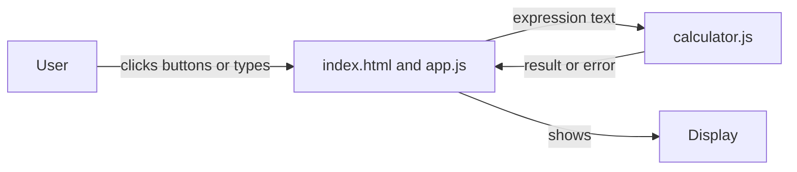

# Design: Scientific Calculator

## Overview

The Scientific Calculator is a single web page that a User opens at `/` in a browser, on a phone or a computer. It shows a display above a keypad of buttons. The User types a number or a full expression, presses equals, and the calculator evaluates it and shows the result in the display. It covers arithmetic, powers, roots, trigonometry and logarithms, shows a clear message when an expression cannot be calculated, and keeps no history: a reload starts with an empty display.

There is no server, no database and no sign-in. The app is plain HTML, CSS and JavaScript, served as static files, and deployed to static hosting (Netlify or GitHub Pages).

## Architecture

The app is three static files plus one module of pure calculation code:

- `index.html` holds the calculator screen: the display, the keypad and the degrees/radians switch.
- `styles.css` holds the look and feel of the screen, for phones and computers.
- `app.js` holds the screen's behaviour: it reads button clicks and keyboard input, writes the expression into the display, and calls the evaluator when the User presses equals.
- `calculator.js` holds the evaluator: a tokenizer, a parser and an evaluator for the expression language below. It has no access to the page, so it can be tested on its own with Node's built-in test runner.



The page is opened by a static file server during development and by the static host in production. Nothing is stored between visits: no cookies, no browser storage, no history.

## Components and Interfaces

### `calculator.js` — the evaluator

Exports one function:

```js
evaluate(expression, options) -> { ok: true, value: number } | { ok: false, message: string }
```

- `expression` is the text in the display, such as `(2 + 3) × 4` or `sin(30)`.
- `options` is `{ angleMode: 'deg' | 'rad' }`, used by `sin`, `cos` and `tan`.
- On success it returns `{ ok: true, value }` with a JavaScript number.
- On failure it returns `{ ok: false, message }`, where `message` is exactly one of:
  - `Cannot divide by zero` — a division by zero, or a logarithm of zero or of a negative number, or the square root of a negative number.
  - `Invalid expression` — anything else the calculator cannot read: an expression that ends in an operator, unbalanced brackets, an unknown character, or a function without its bracket.

The evaluator never throws; every failure comes back as `{ ok: false, message }`.

### Expression language

| Written in the display | Meaning |
| --- | --- |
| `0`–`9`, `.` | a number, such as `3.5` |
| `+`, `−`, `×`, `÷` | add, subtract, multiply, divide |
| `^` | power, right-associative: `2 ^ 3 ^ 2` is `2 ^ (3 ^ 2)` |
| `(`, `)` | grouping |
| `√(x)` | square root |
| `sin(x)`, `cos(x)`, `tan(x)` | trigonometry, in the selected angle mode |
| `log(x)` | base-10 logarithm |
| `ln(x)` | natural logarithm |

Precedence, from tightest to loosest: functions and brackets, then `^`, then `×` and `÷`, then `+` and `−`. A leading `−` is allowed, as in `−5 + 2`.

### Display formatting

A result is shown with up to 10 significant digits, and trailing zeros are removed: `0.5`, not `0.5000000000`; `20`, not `20.00000000`. A result too large or too small to show as a plain number is shown in exponent form, such as `1e+21`.

### `app.js` — the screen

- Holds the current expression as a string, and the angle mode (`'deg'` by default).
- Each keypad button carries a `data-key` attribute; a click appends that key's text to the expression and redraws the display.
- Keys: `0`–`9`, `.`, `+`, `−`, `×`, `÷`, `^`, `(`, `)`, `√(`, `sin(`, `cos(`, `tan(`, `log(`, `ln(`, `=`, `C` (clear) and `⌫` (backspace).
- Keyboard input: digits, `.`, `+`, `-`, `*`, `/`, `^`, `(`, `)` are added to the display; `Enter` or `=` presses equals; `Backspace` removes the last character; `Escape` clears. `*` and `/` are shown as `×` and `÷`.
- Equals calls `evaluate(expression, { angleMode })`. On success the display shows the formatted result and the expression becomes that result, so the User can carry on from it. On failure the display shows the error message and the expression is kept, so the User can change it.
- Clear empties the display and removes any error message.
- The degrees and radians buttons set the angle mode and show the selected one as pressed (`aria-pressed="true"`).

### Shared state between the screen and the evaluator

The only thing the two parts share is the call above: `evaluate(expression, { angleMode })` and its `{ ok, value }` or `{ ok: false, message }` answer. The screen never parses the expression itself, and the evaluator never touches the page.

## Data Models

There is no database and nothing is stored. The app keeps only what is on the screen while it is open:

- `expression`: the text in the display, a string.
- `angleMode`: `'deg'` or `'rad'`, starting as `'deg'`.
- `error`: the message shown, or empty.

A reload starts with an empty expression, degrees and no error.

## Error Handling

Every failure is shown in the display, in place of the result, and the expression stays so the User can fix it:

| Situation | Message |
| --- | --- |
| Division by zero, such as `5 ÷ 0` | `Cannot divide by zero` |
| Logarithm of zero or of a negative number, such as `log(0)` | `Cannot divide by zero` |
| Square root of a negative number, such as `√(−4)` | `Cannot divide by zero` |
| Expression ending in an operator, such as `12 +` | `Invalid expression` |
| Unbalanced brackets, such as `(2 + 3` | `Invalid expression` |
| Any other text the calculator cannot read | `Invalid expression` |

Clear removes the message and empties the display.

## Testing Strategy

- `calculator.js` is tested on its own with Node's built-in test runner (`node --test`), with no browser: each worked example in the requirements (`12 + 8` is `20`, `7 × 6` is `42`, `(2 + 3) × 4` is `20`, `2 ^ 10` is `1024`, `√(81)` is `9`, `sin(30)` is `0.5`, `cos(60)` is `0.5`, `tan(45)` is `1`, `log(1000)` is `3`, `ln(1)` is `0`) and each error case.
- The screen is checked in a browser: the display above the keypad, buttons adding to the display, equals showing the result, the error message with the expression kept, clear, and the degrees/radians switch.

## Build and run
Install: none
Test: node --test
Run locally: yes
Dev: npx serve . -l %PORT%
Port variable: PORT
Health path: /
Deploy: static

## Look and feel

A clean, modern calculator: a dark surface on a soft light page, with a clear display and rounded keys.

- Colours: page background `#eef1f6`; calculator surface `#1f2430`; display background `#151a23`; text `#f5f7fa`; muted text `#9aa4b2`; primary `#4f8cff` (equals and the selected angle mode); error `#ff6b6b`; success `#3ddc97`.
- Font: `system-ui, -apple-system, "Segoe UI", Roboto, sans-serif`; the display uses `ui-monospace, "SFMono-Regular", Menlo, monospace` at 2rem.
- Spacing: 8px steps (8, 16, 24); corner radius 12px for the calculator, 10px for keys, 8px for the display.
- Buttons: dark keys `#2b3242` with light text; function keys `#39415a`; equals in primary `#4f8cff` with white text. Hover lightens the key by one step; focus shows a 2px primary outline; pressed darkens the key and moves it down 1px; disabled keys are at 40% opacity.
- Fields: the display is a read-only area with muted placeholder text when empty, and the error message in the error colour.
- Lists: none.

### Phone layout

The calculator fills the width of the screen with 16px margins, the display across the top, then a row with the degrees/radians switch, then the keypad in a 5-column grid of equal keys with 8px gaps. Every button is at least 44px tall and all of them fit without scrolling sideways.

### Computer layout

The calculator is a card 360px wide, centred on the page with the same display, switch and 5-column keypad, with a soft shadow and 24px padding.

## Assumptions

- The app is served as static files from the app's root, so `/` opens `index.html`.
- `npx serve .` serves the folder and reads the `PORT` variable through its `-l` option; the health path `/` answers with the page.
- The evaluator is a small hand-written tokenizer and parser, not a third-party library, so the app has nothing to install.
- The display shows the expression as the User enters it, and the result replaces it after equals.
- Trigonometry starts in degrees when the page opens.
